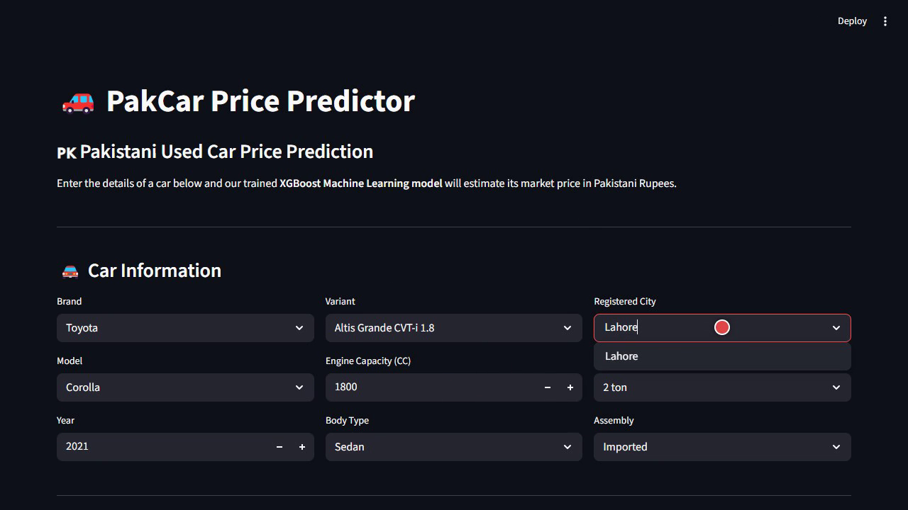
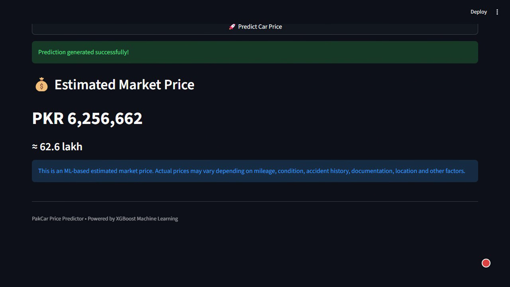

# PakCar Price Predictor 🚗🇵🇰

Predicts the market price of a used car in Pakistan, in PKR.

This is a complete machine learning project, from raw web data to a working app:

1. **Scraper:** collects used-car ads from PakWheels with Playwright.
2. **Cleaning:** turns raw ads into a 50+ column dataset.
3. **Model:** XGBoost regression, trained and tested on held-out data.
4. **App:** a Streamlit page where you choose a car and get a price estimate.

## Demo

| Choose the car | Get the price |
|---|---|
|  |  |

## Results

Measured on **1,556 test cars the model never saw during training** (20% split, `random_state=42`):

| Metric | Score |
|---|---|
| R² | **0.974** |
| Mean absolute % error | **8.0%** |
| Predictions within ±10% of the real price | **73.1%** |
| Mean absolute error | PKR 2.49 lakh |
| 5-fold cross-validation R² | 0.970 ± 0.013 |

Full numbers: [`models/metrics.json`](models/metrics.json). Run `python train.py` to reproduce them.

The features that move price the most are ABS, cruise control, airbags, immobilizer, push start and engine CC (see [`models/feature_importance.csv`](models/feature_importance.csv)).

## Dataset

| | |
|---|---|
| Listings scraped | 7,835 |
| Listings with a valid price (used for training) | 7,777 |
| Brands / models | 19 / 70 |
| Model years | 1976 – 2026 |
| Inputs per car | brand, model, variant, year, engine CC, body type, city, colour, assembly + 35 feature flags (ABS, airbags, sunroof, cruise control, push start…) |

Top brands: Suzuki (4,439), Toyota (1,369), KIA (527), Changan (441), Hyundai (431), Honda (402).

## Project structure

```
scraper/     Playwright crawler: listing collector, ad parser, retries,
             random delays, checkpoint/resume, CSV + Excel export, cleaner
data/        processed/cleaned_cars.csv (+ .xlsx)
notebooks/   01_EDA.ipynb, 02_Preprocessing.ipynb
train.py     trains the model and writes models/metrics.json
models/      pak_car_price_xgboost.pkl, metrics.json, feature_importance.csv
app/         app.py (Streamlit UI), predict.py (predict from Python)
```

## How the scraper works

- Builds a search URL for each brand and model in `scraper/config.py`, then walks through the result pages.
- Opens each ad and reads the title, price, city, engine, body type, assembly and the feature list.
- Waits a random 0.8–1.8 seconds between requests, retries failed pages 3 times, and saves a checkpoint every 50 ads, so a stopped run can resume.
- `cleaner.py` converts prices like "45 lacs" and "1.2 crore" to numbers, splits the title into brand / model / variant / year, and turns the feature list into 0/1 columns.

## Run it yourself

```bash
git clone https://github.com/hassamjaved83-cell/pakcar-price-predictor.git
cd pakcar-price-predictor
pip install -r requirements.txt

# 1. Train (optional: a trained model is already in models/)
python train.py

# 2. Start the app
streamlit run app/app.py
```

To scrape fresh data, run this first:

```bash
playwright install chromium
cd scraper
python main.py
python cleaner.py
```

## Model details

- Pipeline: `OneHotEncoder` for text columns, with numbers and feature flags passed straight through, feeding `XGBRegressor` (800 trees, depth 6, learning rate 0.05).
- The model learns `log(price)` so a 10% error counts the same for a Mehran as for a Fortuner. `predict()` still returns PKR.
- Ads priced below PKR 3 lakh or above PKR 15 crore are dropped as data errors.
- Accuracy is measured on a 20% test split the model never saw, plus 5-fold cross-validation on the training part.

## Tech

Python · Playwright · Pandas · Scikit-learn · XGBoost · Jupyter · Streamlit

## Note

The data was collected from public PakWheels listings for learning and research only. Prices are estimates, not valuations.

---

Built by **Hassam Javed**, Oracle Certified Agentic AI Foundations Associate.
